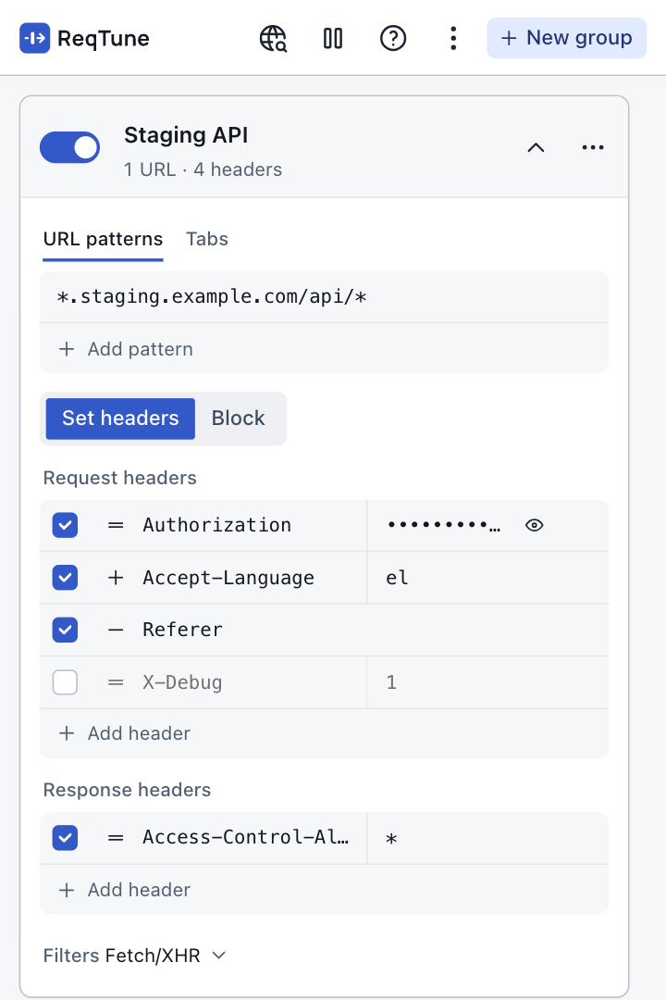
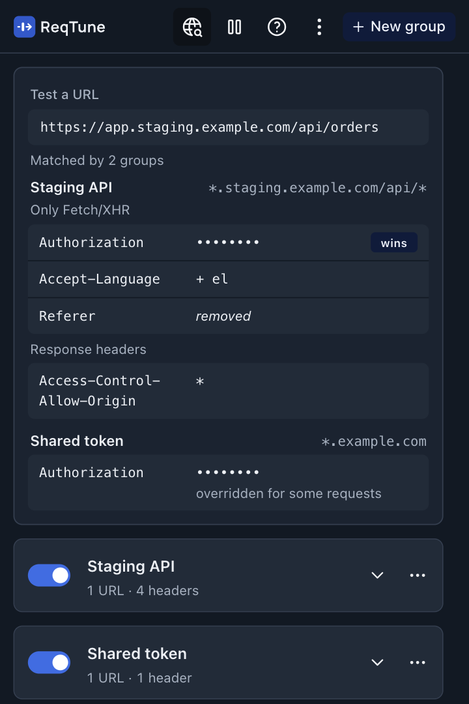
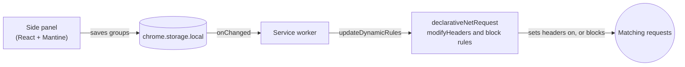

<p align="center">
  <picture>
    <source media="(prefers-color-scheme: dark)" srcset="public/brand/logo-dark.svg">
    
  </picture>
</p>

<p align="center">
  <strong>Set HTTP request headers on the URLs you choose — in groups you can switch on and off, right from Chrome's side panel.</strong>
</p>

<p align="center">
  <a href="https://chromewebstore.google.com/detail/reqtune/mbfeljmpmenkffmmmpakpfmfbohgbcmm">Chrome Web Store</a> · <a href="https://svichas.github.io/ReqTune/">svichas.github.io/ReqTune</a>
</p>

<p align="center">
  
  &nbsp;
  
</p>

## Features

- **Groups** — pair URL patterns with the headers to send, and flip each group on or off.
- **Response headers** — change headers on the responses too, say a `Content-Security-Policy` you want to try before it ships.
- **Pause single headers** — untick the box beside a header to stop sending it without deleting it.
- **Wildcard or regex patterns** — `*.example.com/api/*`, `localhost:3000`, `/graphql` and more, or a regular expression after `regex:` when wildcards aren't enough ([syntax](#pattern-syntax)).
- **Instant** — changes apply as you type (a URL pattern once you leave its field); Chrome sets the headers natively, with no JavaScript in the request path.
- **URL patterns or tabs** — a group targets URL patterns, or switch it to **Tabs** to send its headers on every request from the tabs you pick, say the one you're testing in.
- **Set, append or remove** — replace a header (the default), add your value to the one already there, or strip it out.
- **Request filters** — limit a group to some kinds of requests, say Fetch/XHR or POST only, and leave page loads, images and the rest alone.
- **Block requests** — switch a group to **Block** to cancel the requests it matches instead, and see how a page copes without a script, an API call or analytics.
- **Priority you control** — when groups set the same header, the one higher in the list wins. Reorder from the ⋯ menu.
- **Pause all** — stop every group at once from the header or with Alt+Shift+P, and resume with each group's own switch as you left it. The toolbar icon shows OFF while paused.
- **Screen-share safe** — values of `Authorization`, `Cookie` and other token-like headers show as dots until you reveal them.
- **Comfortable editing** — header name suggestions, duplicate groups, undo deletes, Enter to add a row, Backspace to drop an empty one.
- **User-Agent presets** — a `User-Agent` row's value field suggests common Chrome, Safari, Firefox, Googlebot, Bingbot and curl strings, or type your own. Only the header changes: `navigator.userAgent` and client hints (`Sec-CH-UA-*`) still report your real browser.
- **Side panel or full page** — the panel stays open while you browse; open it as a full page when long tokens need more room, and edits stay in sync between the two. Light and dark themes follow your system.
- **Private** — everything stays in local extension storage; ReqTune makes no network requests and collects nothing.

## Install

You need Chrome 116+.

**From the Chrome Web Store:** [add ReqTune to Chrome](https://chromewebstore.google.com/detail/reqtune/mbfeljmpmenkffmmmpakpfmfbohgbcmm). Chrome keeps it up to date.

**From a release:** download the zip from the [latest release](https://github.com/svichas/ReqTune/releases/latest) and unzip it. Open `chrome://extensions`, turn on **Developer mode**, click **Load unpacked** and pick the unzipped folder.

**From source** (needs Node.js 22.12+):

```bash
git clone https://github.com/svichas/ReqTune.git
cd ReqTune
npm install
npm run build
```

Then load the `dist/` folder the same way.

## Usage

1. Click the ReqTune icon in the toolbar to open the side panel (pin it from the puzzle-piece menu for one-click access).
2. Click **New group**, type a URL pattern, then a header name and value. That's it — matching requests now carry the header.
3. Use the switch to pause a group, and the ⋯ menu to duplicate, move or delete it.
4. To target tabs instead of URLs, switch the group from **URL patterns** to **Tabs** and tick the tabs: every request they make gets the headers, whatever its URL. In the side panel, the tab you're on is ticked for you. Tab picks last until Chrome restarts (or ReqTune updates), because Chrome gives tabs new ids then.
5. To see how a page copes without a script, an API call or analytics, switch the group from **Set headers** to **Block**: Chrome cancels the requests it matches before they're sent. A block beats every group's headers, wherever it sits in the list, and the header rows stay for when you switch back. Careful with **Tabs**: a group that blocks a tab blocks its page loads too, unless its Filters leave them out, so a reload leaves the tab blank but for Chrome's blocked-page error. That's why a blocking group doesn't tick the tab you're on for you.

To stop every group at once, click the pause button in the header or press **Alt+Shift+P** (**Option+Shift+P** on a Mac). Until you resume, the same way or with **Resume** in the panel, no headers are changed and the toolbar icon shows **OFF**. Each group keeps its own switch, and you can keep editing. Change the shortcut at `chrome://extensions/shortcuts`.

To limit a group to some kinds of requests, open **Filters** below its headers and pick resource types (**Page loads**, **Fetch/XHR**, **Scripts** and more; **Other** covers the rest, such as beacons and CSP reports), methods (**GET**, **POST**…) or both. A request must match a picked type and a picked method; a list with nothing picked matches everything, so a new group starts on **All requests**. Chrome only matches methods on HTTP requests, so picking one also leaves out WebSockets: a group with **WebSocket** as its only type then shows **Inactive**.

Need more room? **Open in full page** at the bottom of the panel shows the same groups in a tab of their own, with wider fields for long values.

The button before each header's name picks what happens to that header: **Set** (`=`, the default) replaces it, **Append** (`+`) adds your value to the one already there, and **Remove** (`−`) strips it, so the row needs no value. On requests, Chrome only appends to a fixed list of standard headers, such as `Accept`, `Accept-Language`, `Cookie`, `User-Agent` and `X-Forwarded-For`; on any other, the row shows an error and isn't sent. Appends add up: one from a group lower in the list still adds to a header that a group above it sets.

**Response headers**, below the request headers, go on the responses to the same requests; a group needs a valid header in either list. **Set** replaces any header of that name the server sent, so a `Set-Cookie` row replaces every cookie those responses set; **Append** adds one more instead, and works on any response header. **Remove** strips a header, say an `X-Frame-Options` that keeps a page out of frames. They change headers only: a response's status code and body stay as the server sent them.

The **Tabs** picker shows a small search field when more than 10 tabs are available. Search by title or URL; **Select all** / **Unselect all** below the list applies to all available tabs, including those hidden by the search.

A group shows **Inactive** until it has a valid, ticked header (a blocking group needs none) and something to target: a valid pattern or, when it targets tabs, a picked tab that's still open.

## Pattern syntax

`[scheme://]host[:port][/path]` — `*` matches any characters.

| Pattern | Matches |
| --- | --- |
| `example.com` | Every URL on example.com — any scheme (http, https, ws, wss), port and path |
| `*.example.com` | example.com **and** all of its subdomains |
| `api.example.com/v1/*` | Everything under `/v1/` on that host |
| `localhost:3000` | Only port 3000 |
| `https://example.com/*` | HTTPS requests only |
| `/graphql` | That path on any host |
| `example.com/search?q=*` | Paths whose query string matches too |
| `regex:^https://(api\|admin)\.example\.com/v[0-9]+/` | URLs the regular expression after `regex:` matches, here any API version on two hosts |

- In the host, `*` never crosses a `/`, so `example.com` can't match `example.com.evil.com`.
- No path means the whole site. A path must match in full; the query string is ignored unless the pattern contains `?`.
- Leave out default ports (`:80`, `:443`): Chrome removes them from URLs, so they never match.
- A pattern applies once you leave its field or press Enter, as a half-typed one like `*` or `regex:^https://` would match every site.
- A `regex:` pattern goes to Chrome as written: it matches anywhere in the URL unless you anchor it with `^`. Chrome reads it as [RE2](https://github.com/google/re2/wiki/Syntax), which has no lookarounds or backreferences, and accepts only ASCII.
- Chrome limits how complex each pattern can be. Very long patterns (roughly 70+ characters, or many `*`) are flagged in the panel and skipped, and every other rule keeps working.

## How it works



The background service worker turns every enabled group into one [`declarativeNetRequest`](https://developer.chrome.com/docs/extensions/reference/api/declarativeNetRequest) rule per URL pattern. Each wildcard pattern compiles to an anchored regex (a `regex:` pattern is used as written), rules cover every resource type (including page navigations) and method unless the group's Filters narrow them, and each rule set is swapped atomically so edits never leave it half-applied. Group order becomes rule priority.

A group that targets tabs becomes a single session rule with a `tabIds` condition and no URL filter, so it matches every request from those tabs; session rules are the only kind Chrome lets match by tab. Tab ids are only valid until Chrome restarts, so the picks live in `chrome.storage.session`, which Chrome clears at the same time, and a stale id can never match a new tab.

## Permissions

| Permission | Why |
| --- | --- |
| `declarativeNetRequestWithHostAccess` | Apply the header and block rules |
| `storage` | Save your groups |
| `sidePanel` | Show the UI in Chrome's side panel |
| `favicon` | Show site icons in the tab picker, from Chrome's icon cache. Adds no install warning, since ReqTune already has site access. |
| Access to all sites | Set headers on, or block requests to, whichever sites your patterns name. You can narrow this in the extension's Chrome settings. |

Header values (tokens included) are stored unencrypted in the extension's local storage.

## Development

```bash
npm run dev        # rebuild dist/ on every change, then reload the extension
npm test           # unit tests (Vitest)
npm run typecheck
npm run build
```

```
src/
  background/   service worker: groups → declarativeNetRequest rules
  shared/       types, storage, validation, URL pattern → regex
  ui/           side panel (React + Mantine); brand theme in ui/brand.ts
public/         manifest.json, icons, logo
brand.md        colors, typography and logo usage
```

## License

[MIT](LICENSE) © 2026 Stefanos Vichas
