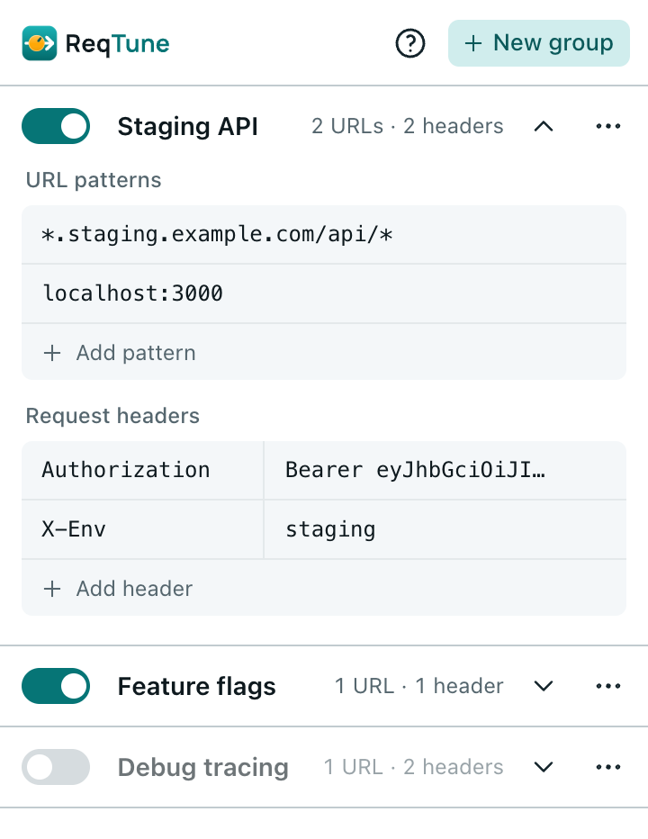
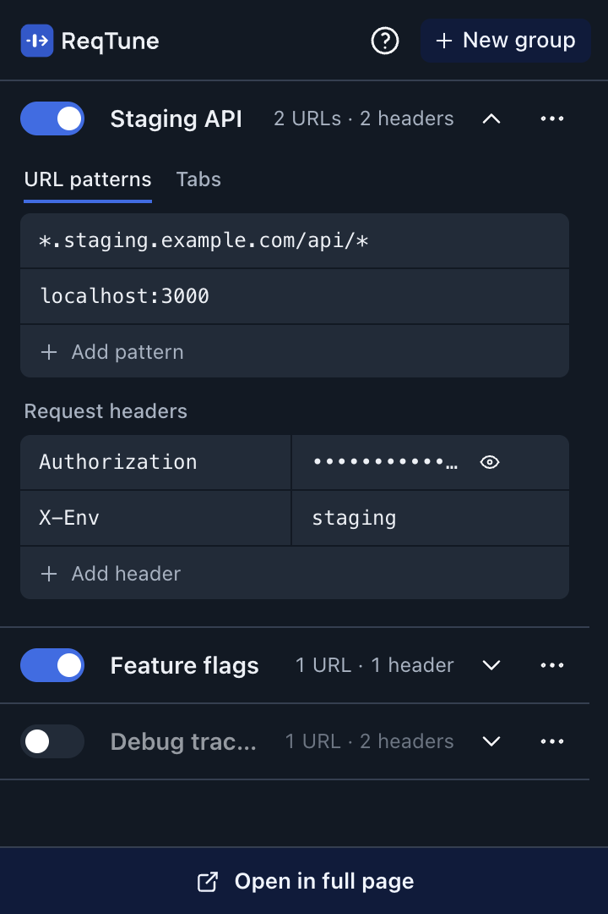
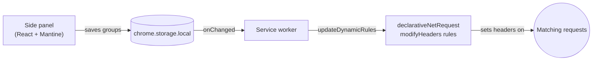

<p align="center">
  <picture>
    <source media="(prefers-color-scheme: dark)" srcset="public/brand/logo-dark.svg">
    
  </picture>
</p>

<p align="center">
  <strong>Set HTTP request headers on the URLs you choose — in groups you can switch on and off, right from Chrome's side panel.</strong>
</p>

<p align="center">
  
  &nbsp;
  
</p>

## Features

- **Groups** — pair wildcard URL patterns with the headers to send, and flip each group on or off.
- **Wildcard patterns** — `*.example.com/api/*`, `localhost:3000`, `/graphql` and more ([syntax](#pattern-syntax)).
- **Instant** — changes apply as you type; Chrome sets the headers natively, with no JavaScript in the request path.
- **Priority you control** — when groups set the same header, the one higher in the list wins. Reorder from the ⋯ menu.
- **Screen-share safe** — values of `Authorization`, `Cookie` and other token-like headers show as dots until you reveal them.
- **Comfortable editing** — header name suggestions, duplicate groups, undo deletes, Enter to add a row, Backspace to drop an empty one.
- **Side panel** — stays open while you browse; light and dark themes follow your system.
- **Private** — everything stays in local extension storage; ReqTune makes no network requests and collects nothing.

## Install

ReqTune isn't on the Chrome Web Store yet. You need Chrome 116+.

**From a release:** download the zip from the [latest release](https://github.com/svichas/ReqTune/releases/latest) and unzip it. Open `chrome://extensions`, turn on **Developer mode**, click **Load unpacked** and pick the unzipped folder.

**From source** (needs Node.js 22.12+):

```bash
git clone https://github.com/svichas/ReqTune.git
cd ReqTune
npm install
npm run build
```

Then load the `dist/` folder the same way.

## Usage

1. Click the ReqTune icon in the toolbar to open the side panel (pin it from the puzzle-piece menu for one-click access).
2. Click **New group**, type a URL pattern, then a header name and value. That's it — matching requests now carry the header.
3. Use the switch to pause a group, and the ⋯ menu to duplicate, move or delete it.

A group shows **Inactive** until it has at least one valid pattern and one valid header.

## Pattern syntax

`[scheme://]host[:port][/path]` — `*` matches any characters.

| Pattern | Matches |
| --- | --- |
| `example.com` | Every URL on example.com — any scheme (http, https, ws, wss), port and path |
| `*.example.com` | example.com **and** all of its subdomains |
| `api.example.com/v1/*` | Everything under `/v1/` on that host |
| `localhost:3000` | Only port 3000 |
| `https://example.com/*` | HTTPS requests only |
| `/graphql` | That path on any host |
| `example.com/search?q=*` | Paths whose query string matches too |

- In the host, `*` never crosses a `/`, so `example.com` can't match `example.com.evil.com`.
- No path means the whole site. A path must match in full; the query string is ignored unless the pattern contains `?`.
- Leave out default ports (`:80`, `:443`): Chrome removes them from URLs, so they never match.
- Chrome limits how complex each pattern can be. Very long patterns (roughly 70+ characters, or many `*`) are flagged in the panel and skipped, and every other rule keeps working.

## How it works



The background service worker turns every enabled group into one [`declarativeNetRequest`](https://developer.chrome.com/docs/extensions/reference/api/declarativeNetRequest) rule per URL pattern. Each pattern compiles to an anchored regex, rules cover every resource type (including page navigations), and the whole rule set is swapped atomically so edits never leave it half-applied. Group order becomes rule priority.

## Permissions

| Permission | Why |
| --- | --- |
| `declarativeNetRequestWithHostAccess` | Apply the header rules |
| `storage` | Save your groups |
| `sidePanel` | Show the UI in Chrome's side panel |
| Access to all sites | Set headers on whichever sites your patterns name. You can narrow this in the extension's Chrome settings. |

Header values (tokens included) are stored unencrypted in the extension's local storage.

## Development

```bash
npm run dev        # rebuild dist/ on every change, then reload the extension
npm test           # unit tests (Vitest)
npm run typecheck
npm run build
```

```
src/
  background/   service worker: groups → declarativeNetRequest rules
  shared/       types, storage, validation, URL pattern → regex
  ui/           side panel (React + Mantine); brand theme in ui/brand.ts
public/         manifest.json, icons, logo
brand.md        colors, typography and logo usage
```

## License

[MIT](LICENSE) © 2026 Stefanos Vichas
